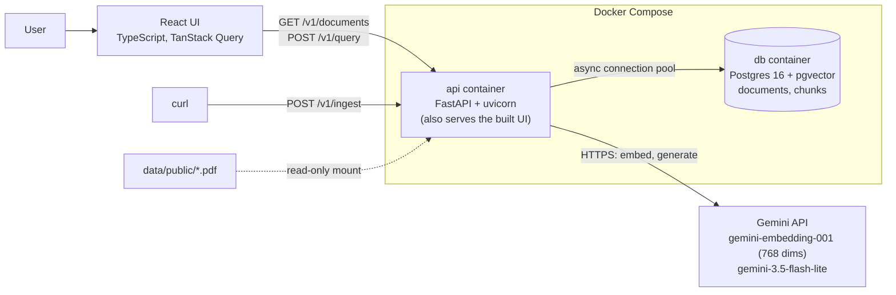

# SpecSeek

Ask a question about an engineering standard and get an answer that cites the clause it came from.

SpecSeek is a retrieval-augmented generation (RAG) service over four public software standards from
NASA and the FDA (225 pages). It answers only from the documents, quotes requirement words such as
"shall" and "should" exactly, and says "I don't know based on these documents" when the answer is
not there.

**Status:** complete as a local project. It runs with Docker Compose on one machine. It is **not
deployed** to a cloud host (see [Limitations](#limitations)).

## What it does

- **Ingest** a PDF: extract the text, cut it into chunks, embed each chunk, store text and vectors
  in Postgres with pgvector. Re-sending the same file changes nothing (idempotent by content hash).
- **Answer** a question: embed it, find the five closest chunks, and give only those passages to an
  LLM with strict grounding rules. The response carries the answer and the passages used.
- **Compare two chunking strategies** on the same questions: fixed 512-character windows (`naive`)
  against one chunk per numbered clause (`section_aware`).

The retrieval pipeline is written by hand, without LangChain or LlamaIndex, so every step is visible.

## Results

Twenty questions with known answers, run against both chunking strategies with everything else held
constant, graded by hand. Full method, per-question failures and the grading review are in
[docs/EVAL.md](docs/EVAL.md).

| Strategy | Correct | Partial | Wrong | Correctly refused |
|---|---|---|---|---|
| `naive` | 10 | 3 | 5 | 2 of 2 |
| `section_aware` | 14 | 2 | 2 | 2 of 2 |

Of the 18 answerable questions, section-aware answered 14 correctly and naive 10. That is a
difference of four questions from one run and one grader: a direction, not a proven effect size.
Nine of the twelve imperfect answers were retrieval or chunking failures, not generation failures.

Latency for one question, measured over 24 sequential requests ([docs/PERF.md](docs/PERF.md)):
typical (p50) 1.30 s, slow (p95) 2.05 s. The LLM call is 77% of that, the embedding call 23%, and
the vector search about 2 ms.

## Architecture



A question travels: validate → rate limit → embed the question → top-5 cosine search in Postgres →
build a grounded prompt → generate at temperature 0 → answer plus citations. The whole path has a
50-second deadline, and each stage's duration is returned in a `Server-Timing` header.

| Endpoint | Purpose |
|---|---|
| `POST /v1/query` | Answer a question; optional `document_id` filter and `strategy` |
| `POST /v1/ingest` | Ingest a PDF from the data folder; 201 when new, 200 when already ingested |
| `GET /v1/documents` | List documents with chunk counts; cursor pagination |
| `GET /v1/health` | Liveness and database connectivity (200 or 503) |

Errors from every endpoint share one JSON shape with a stable `code` and a `request_id` that also
appears in the structured logs.

## Run it

You need Docker with the Compose plugin and a Google Gemini API key. The free tier is enough; a key
comes from <https://aistudio.google.com>.

```bash
git clone <this repository> specseek && cd specseek
cp .env.example .env
```

Open `.env` and set `GEMINI_API_KEY`. Then:

```bash
docker compose up --build -d
curl localhost:8000/v1/health
```

The database starts empty, so ingest the documents. Each call returns when the document is stored:

```bash
for f in FDA-Off-The-Shelf-Software-Guidance-2023 FDA-Premarket-Software-Guidance-2023 NASA-STD-8739.8B; do
  curl -X POST localhost:8000/v1/ingest -H 'Content-Type: application/json' \
    -d "{\"path\": \"public/$f.pdf\"}"; echo
done
```

**Free-tier note:** these three documents need 901 embeddings and take about 8 minutes, most of it
waiting out the provider's per-minute limit. The free tier allows 1,000 embeddings a day, so the
fourth document (`public/NPR-7150.2D.pdf`, 695 embeddings) has to wait until the next day. A failed
or repeated ingest is safe: nothing partial is written, and a repeat returns the existing document.

Open <http://localhost:8000>, or ask from the command line:

```bash
curl -s -X POST localhost:8000/v1/query -H 'Content-Type: application/json' \
  -d '{"question": "What makes a piece of software count as safety-critical?"}'
```

Interactive API documentation is at <http://localhost:8000/docs>.

## Develop

Backend (Python 3.12, managed with [uv](https://docs.astral.sh/uv/)):

```bash
uv sync
docker compose up -d db
uv run pytest            # 166 tests; the database tests use a separate specseek_test database
uv run ruff check .
uv run --env-file .env uvicorn app.main:app --reload --port 8000
```

Frontend (Node 24):

```bash
cd frontend
npm ci
npm test                 # 21 tests
npm run dev              # http://localhost:5173, calls the API on :8000
```

Evaluation and latency (both call the real provider and use quota):

```bash
uv run --env-file .env python -m eval.run_eval run     # 20 questions x 2 strategies
uv run python -m eval.load_test                        # paced, stays under 15 requests/minute
```

## Layout

```
app/            FastAPI service
  api/          routes, error handlers, request-ID middleware
  ingest/       PDF parser, the two chunkers, storage
  retrieval.py  top-k cosine search        prompt.py  grounded prompt
  rag.py        embed → search → generate  llm.py     provider client with retries
  rate_limit.py token bucket
frontend/       React + TypeScript UI
eval/           questions, runner, graded runs, latency script and samples
tests/          backend tests
docs/           ARCHITECTURE, DECISIONS, EVAL, PERF, BUGS
data/public/    the four source PDFs
```

## Design notes

Every non-obvious choice is recorded with the alternative that was rejected in
[docs/DECISIONS.md](docs/DECISIONS.md). A few of them:

- **pgvector, not a dedicated vector database.** A few thousand vectors; text, metadata and vector
  live in one row, filters are plain SQL, and a document and its chunks are written in one transaction.
- **Chunk per clause.** A standard is cited by clause, so the chunk boundary is the clause boundary;
  long clauses are split with overlap, and every chunk keeps its clause ID, heading and page.
- **An exact refusal sentence.** Code can detect a refusal by string match, and the evaluation can
  count refusals without interpreting prose.
- **Layered timeouts.** 15 s per provider attempt, 50 s per question, 60 s in the UI: each layer
  gives up before its caller does.
- **Retries where they can help.** The server retries the provider; the UI does not retry a 502,
  because that would multiply quota use.

The bugs found along the way, with root causes, are in [docs/BUGS.md](docs/BUGS.md).
Request traces for every endpoint and the measured numbers are in
[docs/ARCHITECTURE.md](docs/ARCHITECTURE.md).

## Limitations

- **Not deployed.** It has only been run locally. The container is built to run on a platform such
  as Cloud Run (port from `PORT`, configuration from environment variables, graceful shutdown), but
  that has not been tested.
- **No authentication.** Anyone who can reach the service can ask questions and trigger ingestion.
- **Small evaluation.** Twenty questions on four public documents, one grader. The candidate
  questions were proposed by an AI assistant from the document text; I chose and verified them.
- **Known retrieval weaknesses:** an answer spread over two short clauses can lose its second half;
  table rows lose their column labels; one FDA section is chunked too coarsely.
- **Rate limit:** one in-memory bucket (6 at once, 12 per minute) shared by all callers. It is not
  fair between users and only holds with a single server process. The provider's daily quota is not
  limited.
- **Ingestion is synchronous** and takes minutes per document on the free tier.
- **No migrations:** the schema can be created but not evolved.

## Documents

The four PDFs in `data/public/` are publications of US government agencies (NASA and the FDA).
Licensed standards were deliberately kept out of the repository.

| Document | Pages |
|---|---|
| NASA-STD-8739.8B, Software Assurance and Software Safety Standard | 70 |
| NPR 7150.2D, NASA Software Engineering Requirements | 89 |
| FDA, Content of Premarket Submissions for Device Software Functions (2023) | 46 |
| FDA, Off-The-Shelf Software Use in Medical Devices (2023) | 20 |

## About this project

This is a learning project. I am a software engineer with a background in real-time C++ and Python
systems, and I built SpecSeek to learn fullstack and LLM application development: web APIs, Docker,
React, retrieval and evaluation.
