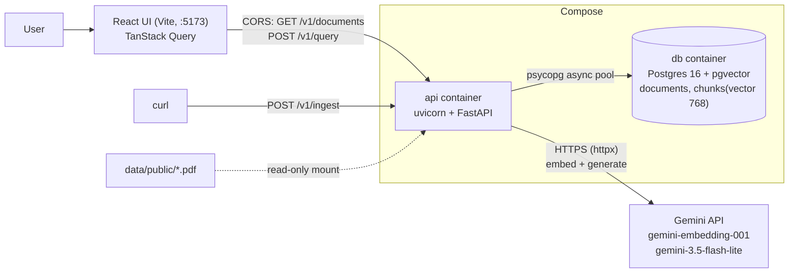

# Architecture

How SpecSeek is put together, what happens on each request, the measured numbers, and what it does
not do. Decisions and their rejected alternatives are in [DECISIONS.md](DECISIONS.md); the
evaluation is in [EVAL.md](EVAL.md); latency is in [PERF.md](PERF.md).

## Overview

In one line: **React UI → API (FastAPI) → [embedding model] → Postgres + pgvector → [LLM] → answer + citations.**
Ingestion is a second path into Postgres: PDF → parse → chunk (naive / section-aware) → embed → store. It has no UI; it is called with curl.

In development the UI (Vite, port 5173) and the API (port 8000) are different origins, which is why the API has CORS.
In the Docker image the API serves the built UI itself, so both share one origin.

Startup: `apply_schema` (advisory lock + idempotent DDL) → `open_pool` (fail fast if DB down) → shared `httpx.AsyncClient`.
Shutdown: SIGTERM → uvicorn stops accepting, drains in-flight requests → lifespan closes the HTTP client and the pool.

## Request traces
`GET /v1/health`:
1. `Depends(database_is_up)` → `db.ping(pool)` borrows a connection (2 s timeout), runs `SELECT 1`.
2. Up → 200 `{"status":"ok","database":"ok"}`; any `psycopg.Error` → 503 `degraded/unavailable`.
   Verified by stopping the db container: 503, then 200 again after restart with no API restart
   (the pool replaces dead connections).

Every request, before and after the route (`app/api/middleware.py:RequestContextMiddleware`):
1. Take `X-Request-ID` from the caller if it's safe, else generate a UUID; store it in a ContextVar.
2. Call the app. On the way out, add `X-Request-ID` to the response headers.
3. Errors: a `SpecSeekError` → `error_handlers.handle_specseek_error` → mapped status + error envelope;
   bad input → 422 envelope; unknown path/verb → 404/405 envelope; anything else is caught by the
   middleware → stack trace logged, generic 500 envelope (no internals leaked).
4. Always: one JSON access-log line with `request_id`, `method`, `path`, `status`, `duration_ms`.

`POST /v1/query` with `{"question": "...", "strategy": "section_aware", "document_id": null}`:
1. `routes.query`: Pydantic validates (question 3–1000 chars, known strategy, UUID) → 422 otherwise. Then `limiter.take()` (token bucket: 6 burst, 12/min) → `RateLimited` → 429 with `Retry-After`, before anything is spent.
   Steps 2–4 run under one 50 s deadline (`asyncio.timeout`); on expiry the in-flight call is cancelled → `ProviderError` → 502.
2. `rag.answer_question` → `GeminiProvider.embed([question], kind="query")`: one HTTPS call, vector normalised to length 1. Each attempt times out after 15 s. Fails: provider down/overloaded after 3 attempts, or quota → `ProviderError` → 502.
3. One pooled connection: `retrieval.document_exists` if a filter was given (missing → `NotFound` → 404), then `retrieval.search_chunks`: `ORDER BY embedding <=> query LIMIT 5` for that strategy. The connection is released before step 4.
4. `prompt.build_prompt`: numbered passages with `Document | Clause | Heading | Page` headers, question last. `GeminiProvider.generate(SYSTEM_PROMPT, prompt)` at temperature 0. No passages → skip the LLM and return the refusal sentence. Fails: timeout/503 after 3 attempts, blocked or cut-off answer → `ProviderError` → 502.
5. Response: `answer`, `refused` (exact-sentence match), `strategy`, and `citations` = the 5 passages with clause, heading, page, 300-char snippet and score. One log line: `embed_ms`, `search_ms`, `generate_ms`, `top_score`.

`POST /v1/ingest` with `{"path": "public/NPR-7150.2D.pdf"}`:
1. `routes.ingest`: Pydantic validates the body (missing path → 422).
2. `service.resolve_data_path`: the path must resolve inside `DATA_DIR`, be a `.pdf`, and exist. Fails: traversal or wrong type → `IngestError` → 422; missing → `NotFound` → 404.
3. `service.ingest_pdf`: SHA-256 of the file, on a worker thread (`asyncio.to_thread`).
4. `store.find_document_by_hash`: already ingested → **200**, `created: false`, stop. No parsing, no embedding.
5. `parser.parse_pdf` + both chunkers, on a worker thread. Fails: not a PDF / no text layer → `IngestError` → 422.
6. `GeminiProvider.embed`: batches of 100 over HTTPS, retries 429/5xx/timeouts with backoff. No DB connection is held here. Fails: retries exhausted, bad key, or quota asks for a long wait → `ProviderError` → 502.
7. One transaction: `store.insert_document` (`ON CONFLICT (content_hash) DO NOTHING RETURNING id`) then `store.insert_chunks`. If no ID comes back, a concurrent request won: return its document with 200.
8. **201**, `created: true`, chunk counts per strategy. One log line with `parse_ms`, `embed_ms`, `store_ms`.

`GET /v1/documents?limit=20&cursor=...`:
1. FastAPI validates `limit` (1–100) and `cursor` length → 422 otherwise.
2. `PostgresDocumentRepository.list_documents`: decodes the cursor (bad cursor → `InvalidCursor` → 422), runs ONE query: `documents LEFT JOIN chunks ... GROUP BY ... ORDER BY created_at DESC, id DESC LIMIT limit+1`, with `WHERE (created_at, id) < (cursor)` when a cursor is given.
3. Returns `{items, next_cursor}`; `next_cursor` is null on the last page.

## Numbers
| Number | Value |
|---|---|
| Tests | Backend 166 (130 unit, 36 against a real Postgres test database); frontend 21 (Vitest + React Testing Library) |
| Chunk size / overlap | naive: 512 chars, no overlap. section_aware: one chunk per clause, max 3200 chars (≈800 tokens at 4 chars/token), 400-char overlap when a clause is split |
| Embedding model + dimension | Gemini `gemini-embedding-001`, 768 dimensions (truncated from 3072), L2-normalised by us (raw norm measured 0.58) |
| Embedding limits (free tier, measured) | 100 texts per request; about one batch per minute before HTTP 429; **1,000 texts per day per model** |
| Ingest time (measured, free tier) | FDA Off-The-Shelf 143 chunks: 94 s · FDA Premarket 268: 142 s · NASA-STD 490: 272 s · NPR 7150.2D 695: 342 s. Almost all of it is waiting out rate limits; parse 0.2–0.5 s, store 0.1–0.4 s |
| Replay of an ingested file | 200 in 5 ms, no provider call |
| In the database (2026-10-03) | 4 documents, 1,596 chunks (956 naive + 640 section-aware), 14 MB including indexes. pgvector 0.8.6 |
| Vector search (measured, 901 chunks) | top-5 via HNSW index 0.5 ms; exact scan 3.4 ms; filtered by strategy 1.6 ms (planner uses an exact scan) |
| DB pool | min 1 / max 10 connections, 2 s acquire timeout for health |
| Top-k | 5, by cosine similarity (`<=>`), per chunking strategy |
| Generation | `gemini-3.5-flash-lite`, temperature 0, max 2048 output tokens, prompt version v1. Free tier: 500 requests/day, 15/minute (`gemini-3.8-flash` was dropped: 20/day) |
| Corpus size | 4 public documents, 225 pages → 956 naive chunks, 640 section-aware chunks (all in the database since 2026-10-03) |
| Per document (pages → naive / section-aware) | NASA-STD-8739.8B: 70 → 281 / 209 · NPR 7150.2D: 89 → 354 / 341 · FDA Premarket: 46 → 219 / 49 · FDA Off-The-Shelf: 20 → 102 / 41 |
| Parse time | 134–357 ms per document on my machine; chunking under 4 ms |
| Eval scores (my final grades, 2026-10-05, 20 questions, `gemini-3.5-flash-lite`) | section-aware: 14 correct, 2 partial, 2 wrong, 2 correctly refused · naive: 10 correct, 3 partial, 5 wrong, 2 correctly refused. Answerable only: 78% vs 56% (14 vs 10 of 18) |
| Eval failures | 12 answers not fully correct (8 naive, 4 section-aware): 9 retrieval/chunking, 2 refusals over text that was present, 1 fabricated citation. No false statement about a requirement |
| Eval grading | by me, by hand; a review changed 2 of 40 grades (first pass was 15 vs 11) |
| Query latency (measured 2026-10-05, 24 sequential requests, `gemini-3.5-flash-lite`) | **p50 1.30 s, p95 2.05 s**. Stages p50: embed 283 ms, search 2 ms, generate 980 ms. Share: generate 77%, embed 23%, search 0.2%, everything else about 3 ms |
| Latency under concurrency | 6 simultaneous requests: p50 1.69 s, all done within 2.04 s (sequentially they would take about 8 s) |
| Prompt size (from the eval run) | retrieved context per question: naive always 2,560 chars; section-aware median 3,626, max 13,792 |
| Cost per query | money: zero on the free tier, not measured for paid. Quota: 1 embedding (1,000/day) + 1 generation (500/day, 15/min). Roughly 1,200 tokens in, 100 out for a median section-aware query (estimated at 4 chars/token) |
| Docker image | 360 MB (three-stage build: Python deps, UI build with Node, slim runtime with neither uv nor Node) |

## Known limitations
- Schema can only be created, not migrated.
- **Not deployed:** runs locally with Docker Compose only; the hosting design below is a plan.
- **No authentication:** anyone who can reach it can ask and can trigger ingestion.
- Free-tier limits shape everything: 1,000 embeddings/day, and for the LLM 500 requests/day and 15/minute. `/v1/query` makes 3 attempts on a busy provider, then returns 502.
- The UI's answer cache is not cleared when a document is re-ingested or the prompt changes (30 minutes, or until reload).
- Eval-proven weaknesses: an answer spread over two short clauses can lose its second half (q09); FDA section VI is chunked too coarsely (q15); table rows lose their column labels (q05).
- Near-duplicate chunks can fill the context (the same requirement appears in NPR's body, its Appendix C matrix and NASA-STD's Table 1); there is no deduplication or reranking.
- The rate limit is one in-memory bucket for all callers: no fairness between users, and it only holds with a single server instance. The daily quota (500 generations) is not limited at all.
- No relevance floor yet: the LLM is called even when the best match is weak.
- Latency was measured at low volume only (36 requests, max 6 at once); 99.7% of it is provider time, so it will move with the provider.
- `citations` lists every passage given to the model, not only the ones it actually cited.
- Ingest is synchronous: minutes per document on the free tier. The scalable design is 202 + queue + worker.
- The whole corpus (1,596 texts) exceeds one day of free embedding quota, so a full re-ingest takes two days on the free tier.
- A re-saved PDF with the same text has a different hash and would be ingested as a new document.
- Chunking: FDA Premarket subsection letters aren't in the PDF text, so section VI is cited coarsely; table rows aren't reconstructed; contents pages remain as noise chunks; clause IDs can repeat within a document (see DECISIONS.md).
- Base image tag `python:3.12-slim` is floating, so image builds aren't byte-reproducible.

## Hosting plan (not done)
SpecSeek has only been run locally (DECISIONS.md, 2026-10-10). This is the intended design, untested:

- Build the image, push it to a registry, run it on a container platform such as Cloud Run with a
  maximum of one instance. Postgres on a hosted service with pgvector. The provider key and the
  database URL come from a secret store as environment variables.
- The container already listens on `PORT`, takes all configuration from environment variables, keeps
  no state on local disk and shuts down gracefully on SIGTERM. It already serves the built UI.

What would have to change:

| Today | Hosted |
|---|---|
| The rate limiter lives in one process's memory | Keep one instance, or move the bucket to a shared store |
| Ingestion reads PDFs from a local folder | Upload to object storage, ideally through a signed URL |
| Ingestion is one long request | A background job (accept, queue, process) |
| Pool of 10 connections | 10 x instances must stay under the database's connection limit |

Open points before using it inside a company:

- **Access:** there is no authentication.
- **Licensed standards:** check that each licence allows storing the text and showing excerpts.
- **Where text is sent:** questions and retrieved passages go to the LLM provider; check its
  data-use terms for the plan in use.
- **Quota:** 500 generations a day does not serve a team.
- **Evaluation:** the 20 questions are on public documents; a new corpus needs its own.
