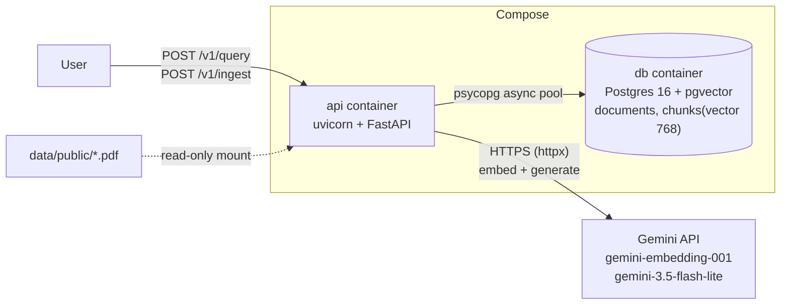

# SpecSeek: interview study guide

Accurate to the code as of **Phase 3** (the full pipeline works: ingest, retrieve, generate, cite; all 4 public documents are in the database; the evaluation has not been run yet).
unbuilt features as if they exist.

## 1. 90-second walkthrough
"SpecSeek answers questions about engineering standards and tells you which clause the answer
comes from. I built it on four public documents: two NASA software standards and two FDA
software guidances, 225 pages.

It has two halves. Ingestion takes a PDF, pulls out the text, cuts it into chunks, turns each
chunk into a vector with an embedding model, and stores text, metadata and vector together in
Postgres with the pgvector extension. Querying embeds the question the same way, asks Postgres
for the five closest chunks, and gives those five passages to an LLM with strict instructions:
answer only from these passages, cite the clause, keep words like 'shall' and 'should' exactly,
and say 'I don't know based on these documents' if the answer isn't there.

The part I spent most time on is chunking. I keep two strategies side by side: a naive one that
cuts every 512 characters, and a section-aware one that makes one chunk per numbered clause, so
an answer can cite 'NPR 7150.2D, clause 3.1.2'. I wrote a 20-question evaluation to compare them.

Around that core it's an ordinary production-style service: FastAPI, async end to end, Docker,
one error format, JSON logs with a request ID, an idempotent ingest endpoint, and cursor
pagination. I wrote the pipeline myself instead of using LangChain so I can explain every step."

Eval sentence to add when speaking: "On my 20-question set, graded by hand, the section-aware
strategy got 14 of 18 answerable questions right and the naive one 10; both refused the two
questions that weren't in the documents. It's a small set, so I treat that as a direction, not a
proof, and I can tell you exactly why each failure happened."

## 2. Architecture

Whiteboard version, five boxes left to right:
**Client → API (FastAPI) → [Embedding model] → Postgres + pgvector → [LLM] → answer + citations.**
Draw ingestion as a second arrow into Postgres: PDF → parse → chunk (naive / section-aware) → embed → store.

Startup: `apply_schema` (advisory lock + idempotent DDL) → `open_pool` (fail fast if DB down) → shared `httpx.AsyncClient`.
Shutdown: SIGTERM → uvicorn stops accepting, drains in-flight requests → lifespan closes the HTTP client and the pool.

## 3. Request traces
`GET /v1/health`:
1. `Depends(database_is_up)` → `db.ping(pool)` borrows a connection (2 s timeout), runs `SELECT 1`.
2. Up → 200 `{"status":"ok","database":"ok"}`; any `psycopg.Error` → 503 `degraded/unavailable`.
   Verified by stopping the db container: 503, then 200 again after restart with no API restart
   (the pool replaces dead connections).

Every request, before and after the route (`app/api/middleware.py:RequestContextMiddleware`):
1. Take `X-Request-ID` from the caller if it's safe, else generate a UUID; store it in a ContextVar.
2. Call the app. On the way out, add `X-Request-ID` to the response headers.
3. Errors: a `SpecSeekError` → `error_handlers.handle_specseek_error` → mapped status + error envelope;
   bad input → 422 envelope; unknown path/verb → 404/405 envelope; anything else is caught by the
   middleware → stack trace logged, generic 500 envelope (no internals leaked).
4. Always: one JSON access-log line with `request_id`, `method`, `path`, `status`, `duration_ms`.

`POST /v1/query` with `{"question": "...", "strategy": "section_aware", "document_id": null}`:
1. `routes.query`: Pydantic validates (question 3–1000 chars, known strategy, UUID) → 422 otherwise.
2. `rag.answer_question` → `GeminiProvider.embed([question], kind="query")`: one HTTPS call, vector normalised to length 1. Fails: provider down/overloaded after 3 attempts, or quota → `ProviderError` → 502.
3. One pooled connection: `retrieval.document_exists` if a filter was given (missing → `NotFound` → 404), then `retrieval.search_chunks`: `ORDER BY embedding <=> query LIMIT 5` for that strategy. The connection is released before step 4.
4. `prompt.build_prompt`: numbered passages with `Document | Clause | Heading | Page` headers, question last. `GeminiProvider.generate(SYSTEM_PROMPT, prompt)` at temperature 0. No passages → skip the LLM and return the refusal sentence. Fails: timeout/503 after 3 attempts, blocked or cut-off answer → `ProviderError` → 502.
5. Response: `answer`, `refused` (exact-sentence match), `strategy`, and `citations` = the 5 passages with clause, heading, page, 300-char snippet and score. One log line: `embed_ms`, `search_ms`, `generate_ms`, `top_score`.

`POST /v1/ingest` with `{"path": "public/NPR-7150.2D.pdf"}`:
1. `routes.ingest`: Pydantic validates the body (missing path → 422).
2. `service.resolve_data_path`: the path must resolve inside `DATA_DIR`, be a `.pdf`, and exist. Fails: traversal or wrong type → `IngestError` → 422; missing → `NotFound` → 404.
3. `service.ingest_pdf`: SHA-256 of the file, on a worker thread (`asyncio.to_thread`).
4. `store.find_document_by_hash`: already ingested → **200**, `created: false`, stop. No parsing, no embedding.
5. `parser.parse_pdf` + both chunkers, on a worker thread. Fails: not a PDF / no text layer → `IngestError` → 422.
6. `GeminiProvider.embed`: batches of 100 over HTTPS, retries 429/5xx/timeouts with backoff. No DB connection is held here. Fails: retries exhausted, bad key, or quota asks for a long wait → `ProviderError` → 502.
7. One transaction: `store.insert_document` (`ON CONFLICT (content_hash) DO NOTHING RETURNING id`) then `store.insert_chunks`. If no ID comes back, a concurrent request won: return its document with 200.
8. **201**, `created: true`, chunk counts per strategy. One log line with `parse_ms`, `embed_ms`, `store_ms`.

`GET /v1/documents?limit=20&cursor=...`:
1. FastAPI validates `limit` (1–100) and `cursor` length → 422 otherwise.
2. `PostgresDocumentRepository.list_documents`: decodes the cursor (bad cursor → `InvalidCursor` → 422), runs ONE query: `documents LEFT JOIN chunks ... GROUP BY ... ORDER BY created_at DESC, id DESC LIMIT limit+1`, with `WHERE (created_at, id) < (cursor)` when a cursor is given.
3. Returns `{items, next_cursor}`; `next_cursor` is null on the last page.

## 4. Numbers to know cold
| Number | Value |
|---|---|
| Tests | 118 (87 unit, 31 integration against a real Postgres test database) |
| Chunk size / overlap | naive: 512 chars, no overlap. section_aware: one chunk per clause, max 3200 chars (≈800 tokens at 4 chars/token), 400-char overlap when a clause is split |
| Embedding model + dimension | Gemini `gemini-embedding-001`, 768 dimensions (truncated from 3072), L2-normalised by us (raw norm measured 0.58) |
| Embedding limits (free tier, measured) | 100 texts per request; about one batch per minute before HTTP 429; **1,000 texts per day per model** |
| Ingest time (measured, free tier) | FDA Off-The-Shelf 143 chunks: 94 s · FDA Premarket 268: 142 s · NASA-STD 490: 272 s · NPR 7150.2D 695: 342 s. Almost all of it is waiting out rate limits; parse 0.2–0.5 s, store 0.1–0.4 s |
| Replay of an ingested file | 200 in 5 ms, no provider call |
| In the database (2026-10-03) | 4 documents, 1,596 chunks (956 naive + 640 section-aware), 14 MB including indexes. pgvector 0.8.6 |
| Vector search (measured, 901 chunks) | top-5 via HNSW index 0.5 ms; exact scan 3.4 ms; filtered by strategy 1.6 ms (planner uses an exact scan) |
| DB pool | min 1 / max 10 connections, 2 s acquire timeout for health |
| Top-k | 5, by cosine similarity (`<=>`), per chunking strategy |
| Generation | `gemini-3.5-flash-lite`, temperature 0, max 2048 output tokens, prompt version v1. Free tier: 500 requests/day, 15/minute (`gemini-3.8-flash` was dropped: 20/day) |
| Corpus size | 4 public documents, 225 pages → 956 naive chunks, 640 section-aware chunks (measured 2026-10-02 by running the chunkers; not yet in the DB) |
| Per document (pages → naive / section-aware) | NASA-STD-8739.8B: 70 → 281 / 209 · NPR 7150.2D: 89 → 354 / 341 · FDA Premarket: 46 → 219 / 49 · FDA Off-The-Shelf: 20 → 102 / 41 |
| Parse time | 134–357 ms per document on my machine; chunking under 4 ms |
| Eval scores (my final grades, 2026-10-05, 20 questions, `gemini-3.5-flash-lite`) | section-aware: 14 correct, 2 partial, 2 wrong, 2 correctly refused · naive: 10 correct, 3 partial, 5 wrong, 2 correctly refused. Answerable only: 78% vs 56% (14 vs 10 of 18) |
| Eval failures | 12 answers not fully correct (8 naive, 4 section-aware): 9 retrieval/chunking, 2 refusals over text that was present, 1 fabricated citation. No false statement about a requirement |
| Eval grading | by me, by hand; a review changed 2 of 40 grades (first pass was 15 vs 11) |
| Query latency (measured 2026-10-05, 24 sequential requests, `gemini-3.5-flash-lite`) | **p50 1.30 s, p95 2.05 s**. Stages p50: embed 283 ms, search 2 ms, generate 980 ms. Share: generate 77%, embed 23%, search 0.2%, everything else about 3 ms |
| Latency under concurrency | 6 simultaneous requests: p50 1.69 s, all done within 2.04 s (sequentially they would take about 8 s) |
| Prompt size (from the eval run) | retrieved context per question: naive always 2,560 chars; section-aware median 3,626, max 13,792 |
| Cost per query | money: zero on the free tier, not measured for paid. Quota: 1 embedding (1,000/day) + 1 generation (500/day, 15/min). Roughly 1,200 tokens in, 100 out for a median section-aware query (estimated at 4 chars/token) |
| Docker image size | 371 MB (`docker image ls`, 2026-10-02, after adding PyMuPDF and numpy via pgvector). Was 274 MB before the ingestion dependencies |

## 5. Decisions
See `DECISIONS.md`. Short form so far:
- Repo on WSL filesystem, not `/mnt/f` → I/O speed and inotify.
- uv + lockfile, not pip + requirements.txt → reproducible installs.
- Repository behind a Protocol → tests inject fakes, Postgres swaps in without touching routes.
- Ruff `ASYNC` rules → catches blocking calls in `async def` statically.
- Licensed PDFs never committed or served publicly → copyright.

## 6. Bugs (STAR)
**The glued heading (2026-10-02).**
- *Situation:* the section-aware chunker passed all 23 unit tests.
- *What I saw:* on the real FDA guidance, 66% of the text had no clause ID; only `VII` and the appendices were detected.
- *Root cause:* the PDF stores `III. Scope` as three spans (`III.`, a space, `Scope`). My parser dropped whitespace-only spans before joining, producing `III.Scope`, which no heading rule matches.
- *Fix:* join all spans for text; ignore whitespace-only spans only for the bold check. Added a regression test. Lesson: unit tests on hand-built input can't catch a parser/PDF interaction; an aggregate check on real data (% of text without a clause ID) did.

**The quota that looked like a rate limit (2026-10-02).**
- *Situation:* three documents ingested fine, each recovering from HTTP 429 after one wait.
- *What I saw:* the fourth retried six times over five minutes and failed with 502, while a single hand-sent request succeeded.
- *Root cause:* two limits share one status code. This 429 was the free tier's 1,000-texts-per-day quota, and its body said to retry in 16,464 s. My code clamped that to 60 s and kept retrying a request that could not succeed.
- *Fix:* if the provider asks for a longer wait than our maximum backoff, fail immediately with the wait in the error message (now 0.8 s instead of 5 minutes). Because the write is one transaction after embedding, the failure left no partial data.

**The dev-only dependency (2026-10-02).** All tests passed locally, but the container crashed on start: `httpx` had been installed as a dev dependency and the image is built without those. Full write-up in BUGS.md.

**Contents entries as clauses (2026-10-02).** 75 of NPR 7150.2D's 391 chunks were one-line contents entries like `P.1 Purpose`. Fixed by treating a title-like one-liner whose ID reappears later as contents text. Full write-up in BUGS.md.

## 7. Known limitations
- Schema can only be created, not migrated.
- Free-tier limits shape everything: 1,000 embeddings/day, and for the LLM 500 requests/day and 15/minute. `/v1/query` retries twice on a busy provider, then returns 502. There is no rate limiter of our own yet.
- Eval-proven weaknesses: an answer spread over two short clauses can lose its second half (q09); FDA section VI is chunked too coarsely (q15); table rows lose their column labels (q05).
- Near-duplicate chunks can fill the context (the same requirement appears in NPR's body, its Appendix C matrix and NASA-STD's Table 1); there is no deduplication or reranking.
- No relevance floor yet: the LLM is called even when the best match is weak.
- Latency was measured at low volume only (36 requests, max 6 at once); 99.7% of it is provider time, so it will move with the provider.
- `citations` lists every passage given to the model, not only the ones it actually cited.
- Ingest is synchronous: minutes per document on the free tier. The scalable design is 202 + queue + worker.
- The whole corpus (1,596 texts) exceeds one day of free embedding quota, so a full re-ingest takes two days on the free tier.
- A re-saved PDF with the same text has a different hash and would be ingested as a new document.
- Chunking: FDA Premarket subsection letters aren't in the PDF text, so section VI is cited coarsely; table rows aren't reconstructed; contents pages remain as noise chunks; clause IDs can repeat within a document (see DECISIONS.md).
- Base image tag `python:3.12-slim` is floating, so image builds aren't byte-reproducible.

## 8. Follow-up ladders
**Async endpoints**
- Q: What happens if you call `time.sleep(2)` in an `async def` endpoint?
  A: It blocks the event loop thread, so all requests serialize: 10 concurrent → last waits ~20 s.
- Follow-up: How do you fix it?
  A: Use an async API (`asyncio.sleep`, `httpx.AsyncClient`); for unavoidable blocking code, `asyncio.to_thread` / `run_in_executor`; or a plain `def` endpoint (FastAPI's threadpool, 40 threads by default).
- Follow-up: When would a thread pool not help?
  A: CPU-bound pure-Python work holds the GIL → use a process pool. Libraries that release the GIL in C code (e.g. PyMuPDF) are fine in threads.

**Retrieval**
- Q: How do you find the relevant passages?
  A: Embed the question, then one SQL query: `ORDER BY embedding <=> query LIMIT 5`, filtered by chunking strategy and optionally by document. `<=>` is cosine distance; I report `1 - distance` as the score.
- Follow-up: Why pgvector and not a vector database?
  A: A few thousand vectors. One system holds text, metadata and vectors in one row, filters are plain `WHERE`, writes are transactional with the document row. A dedicated store pays off at tens of millions of vectors or heavy filtered approximate search.
- Follow-up: Is your search exact or approximate?
  A: Measured with `EXPLAIN ANALYZE`: unfiltered it uses the HNSW index (approximate, 0.5 ms); filtered by strategy the planner picks an exact scan (1.6 ms at 901 chunks). So today my filtered retrieval is exact. If the corpus grew I'd look at a partial index per strategy or pgvector's iterative scan.

**Grounding**
- Q: How do you stop the model from making things up?
  A: The system prompt allows only the supplied passages, demands a citation per statement, and prescribes one exact refusal sentence. Temperature 0. And I measure it: the eval includes unanswerable questions.
- Follow-up: How do you know it refused?
  A: The refusal is a fixed sentence, so code detects it by string match and returns `refused: true`. With zero retrieved passages the service refuses without calling the LLM at all.
- Follow-up: What about a malicious document that says "ignore your instructions"?
  A: The prompt tells the model passages are reference material, not instructions, and they are sent as user content, separate from the system instruction. That reduces the risk; it does not eliminate it. I'd say so rather than claim it's solved.

**Evaluation**
- Q: How do you know it works?
  A: A 20-question set with expected answers and clause references, run against both chunking strategies with everything else held constant, graded by hand. Section-aware: 14 of 18 answerable correct; naive: 10 of 18; both refused both unanswerable questions.
- Follow-up: Is that difference significant?
  A: Not statistically: it is four questions, one run, one grader. I present it as a direction. What I trust more is the failure analysis: for each wrong answer I checked whether the expected text was in the five passages the model received.
- Follow-up: Where did your better strategy lose?
  A: q09: "who writes the plan and who approves it" spans two consecutive clauses. One-chunk-per-clause retrieved the first only; the naive window happened to hold both. The fix I'd try first is passing the neighbouring clause along with a hit.

**Performance**
- Q: How fast is it, and where does the time go?
  A: Measured p50 1.3 s and p95 2.0 s per question. 77% is the LLM call, 23% the embedding call, the vector search is 2 ms, and everything I wrote adds about 3 ms. Each response carries a `Server-Timing` header with the three stages.
- Follow-up: An endpoint is slow. How do you debug it?
  A: Measure first: which stage? Then: every request or just the tail; client/network vs server; is the event loop blocked (do concurrent requests serialize?); database plan and pool waits; third-party calls; payload size; can it be cached. On my data the answer is step six: it is the provider.
- Follow-up: How would you make it faster?
  A: Cache answers for repeated questions, then cache question embeddings; shorter context only if the evaluation shows quality holds. Streaming would improve perceived latency, not total time.

## 9. Concept answers

### What is RAG, why use it, and what are the alternatives?
**What it is (one sentence).** Retrieval-augmented generation: before asking a language model a
question, fetch the passages most relevant to it from your own documents and put them in the
prompt, so the model answers from that text instead of from its memory.

**The problem it solves.** A language model on its own:
- knows only what was in its training data, up to a cutoff date, and nothing private;
- cannot tell you where a statement came from;
- fills gaps with fluent guesses (hallucination), which is unacceptable for requirements text where
  "shall" versus "should" matters.

**How it works (the three steps in SpecSeek).**
1. *Index, once:* split documents into chunks, turn each into a vector with an embedding model,
   store vector + text + metadata (Postgres + pgvector).
2. *Retrieve, per question:* embed the question, take the 5 nearest chunks by cosine similarity.
3. *Generate:* give the model those 5 passages with rules: answer only from them, cite the clause,
   or reply with a fixed refusal sentence.

**Why use it.**
- **Grounding and citations:** every answer points at a clause a human can open and check.
- **Freshness without retraining:** add or replace a document by re-ingesting it; minutes, not a
  training job.
- **Honest refusal:** "not in these documents" is a detectable outcome (both unanswerable eval
  questions were refused).
- **Cost and control:** you send 5 passages per question, not the whole library, and you decide
  which documents are searchable (the basis for per-user access later).

**Alternatives, and when each is the better choice.**
| Alternative | What it is | Better than RAG when | Why not here |
|---|---|---|---|
| Model alone | Ask the LLM directly | General knowledge, no need for sources | No citations, may be outdated or invented |
| Long-context "stuffing" | Put the whole corpus in every prompt | The corpus is small and stable (ours, 225 pages, would fit a 1M-token window) and cost/latency per question don't matter | Every question pays for all 225 pages; quality drops for facts buried mid-context; stops working when the corpus outgrows the window. Honest answer: for a corpus this size it is a real option, especially with prompt caching |
| Fine-tuning | Train the model further on your documents | You need a style, format or skill, not facts | Facts are not reliably memorised, there are no citations, and every document change means retraining |
| Keyword search (BM25) | Classic search engine, no LLM | Users search exact terms, part numbers, IDs | Misses paraphrases ("third-party" vs "off-the-shelf"); returns documents, not answers. Combining it with vectors (hybrid search) is the usual next step |
| Structured query | Facts in tables, queried with SQL (optionally text-to-SQL) | The questions are about structured data: counts, filters, joins | Standards are prose |
| Agentic search | The model decides what to search, reads, searches again | Multi-step questions needing several lookups | More calls, more latency, harder to evaluate; a later step, not a first one |

**Where RAG fails (so I can say it before I'm asked).** It is only as good as retrieval: if the
right passage is not in the top 5, or arrives cut in half, the model cannot answer. In my
evaluation 9 of 12 failures were exactly that, and none was the model inventing a requirement.
That is why most of the work in this project went into chunking, not into the prompt.

**One-line version.** "RAG lets a model answer from my documents with citations, and update by
re-indexing instead of retraining; its weak point is retrieval, which is why I evaluated chunking."

