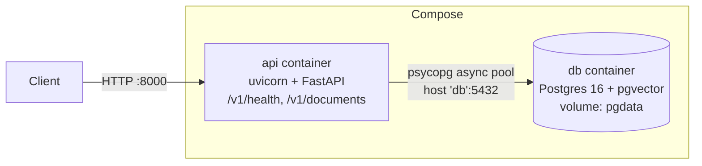

# SpecSeek: interview study guide

Accurate to the code as of **Phase 1** (Docker + Postgres, error handling, structured logging). Sections fill in as phases land; nothing here describes
unbuilt features as if they exist.

## 1. 90-second walkthrough
_(Written after Phase 3, once there is a query path to describe.)_

## 2. Architecture
Current (Phase 1): two containers via Docker Compose. Documents are still in memory until phase 2.

Startup: `apply_schema` (advisory lock + idempotent DDL) → `open_pool` (fail fast if DB down).
Shutdown: SIGTERM → uvicorn stops accepting, drains in-flight requests → lifespan closes the pool.

## 3. Request traces
`GET /v1/health`:
1. `Depends(database_is_up)` → `db.ping(pool)` borrows a connection (2 s timeout), runs `SELECT 1`.
2. Up → 200 `{"status":"ok","database":"ok"}`; any `psycopg.Error` → 503 `degraded/unavailable`.
   Verified by stopping the db container: 503, then 200 again after restart with no API restart
   (the pool replaces dead connections).

Every request, before and after the route (`app/api/middleware.py:RequestContextMiddleware`):
1. Take `X-Request-ID` from the caller if it's safe, else generate a UUID; store it in a ContextVar.
2. Call the app. On the way out, add `X-Request-ID` to the response headers.
3. Errors: a `SpecSeekError` → `error_handlers.handle_specseek_error` → mapped status + error envelope;
   bad input → 422 envelope; unknown path/verb → 404/405 envelope; anything else is caught by the
   middleware → stack trace logged, generic 500 envelope (no internals leaked).
4. Always: one JSON access-log line with `request_id`, `method`, `path`, `status`, `duration_ms`.

`GET /v1/documents` (still in-memory):
1. uvicorn accepts the connection, parses HTTP, builds the ASGI `scope`.
2. FastAPI matches the route → resolves `Depends(get_repository)` → reads `app.state.repo` (set in the lifespan).
3. Handler `await`s `repo.list_documents()` → returns a copy of the list.
4. FastAPI validates the result against `response_model=list[DocumentSummary]` → JSON.
   Can fail: lifespan didn't run → `AttributeError` → 500; output doesn't match the model → 500.

## 4. Numbers to know cold
| Number | Value |
|---|---|
| Tests | 20 (18 unit, 2 integration against real Postgres) |
| Chunk size / overlap | not built yet |
| Embedding model + dimension | Gemini `gemini-embedding-001` @ 768 (chosen; not wired yet) |
| DB pool | min 1 / max 10 connections, 2 s acquire timeout for health |
| Top-k | 5 (planned) |
| Corpus size | not ingested yet |
| Eval scores | not measured |
| p50 / p95 latency | not measured |
| Cost per query | not measured |
| Docker image size | 274 MB (`docker image ls`, 2026-10-02; dependency layer 66.7 MB, app code 61 kB, rest is the python:3.12-slim base). Read 262 MB on 2026-09-30; cause of the difference not investigated |

## 5. Decisions
See `DECISIONS.md`. Short form so far:
- Repo on WSL filesystem, not `/mnt/f` → I/O speed and inotify.
- uv + lockfile, not pip + requirements.txt → reproducible installs.
- Repository behind a Protocol → tests inject fakes, Postgres swaps in without touching routes.
- Ruff `ASYNC` rules → catches blocking calls in `async def` statically.
- Licensed PDFs never committed or served publicly → copyright.

## 6. Bugs (STAR)
_(None yet. Only real bugs from BUGS.md go here.)_

## 7. Known limitations
- Documents not persisted yet (phase 2). Schema can only be created, not migrated.
- No real route raises a domain error yet; the hierarchy is exercised only by tests until phase 2.
- Base image tag `python:3.12-slim` is floating, so image builds aren't byte-reproducible.
- Integration tests share the dev database (no separate test DB).

## 8. Follow-up ladders
**Async endpoints**
- Q: What happens if you call `time.sleep(2)` in an `async def` endpoint?
  A: It blocks the event loop thread, so all requests serialize: 10 concurrent → last waits ~20 s.
- Follow-up: How do you fix it?
  A: Use an async API (`asyncio.sleep`, `httpx.AsyncClient`); for unavoidable blocking code, `asyncio.to_thread` / `run_in_executor`; or a plain `def` endpoint (FastAPI's threadpool, 40 threads by default).
- Follow-up: When would a thread pool not help?
  A: CPU-bound pure-Python work holds the GIL → use a process pool. Libraries that release the GIL in C code (e.g. PyMuPDF) are fine in threads.
