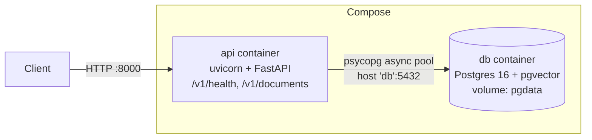

# SpecSeek: interview study guide

Accurate to the code as of **Phase 2** (ingestion works end to end; 3 of 4 public documents are in the database, the fourth is waiting for the embedding quota to reset; no retrieval yet). Sections fill in as phases land; nothing here describes
unbuilt features as if they exist.

## 1. 90-second walkthrough
_(Written after Phase 3, once there is a query path to describe.)_

## 2. Architecture
Current (Phase 1): two containers via Docker Compose. Documents are still in memory until phase 2.

Startup: `apply_schema` (advisory lock + idempotent DDL) → `open_pool` (fail fast if DB down).
Shutdown: SIGTERM → uvicorn stops accepting, drains in-flight requests → lifespan closes the pool.

## 3. Request traces
`GET /v1/health`:
1. `Depends(database_is_up)` → `db.ping(pool)` borrows a connection (2 s timeout), runs `SELECT 1`.
2. Up → 200 `{"status":"ok","database":"ok"}`; any `psycopg.Error` → 503 `degraded/unavailable`.
   Verified by stopping the db container: 503, then 200 again after restart with no API restart
   (the pool replaces dead connections).

Every request, before and after the route (`app/api/middleware.py:RequestContextMiddleware`):
1. Take `X-Request-ID` from the caller if it's safe, else generate a UUID; store it in a ContextVar.
2. Call the app. On the way out, add `X-Request-ID` to the response headers.
3. Errors: a `SpecSeekError` → `error_handlers.handle_specseek_error` → mapped status + error envelope;
   bad input → 422 envelope; unknown path/verb → 404/405 envelope; anything else is caught by the
   middleware → stack trace logged, generic 500 envelope (no internals leaked).
4. Always: one JSON access-log line with `request_id`, `method`, `path`, `status`, `duration_ms`.

`POST /v1/ingest` with `{"path": "public/NPR-7150.2D.pdf"}`:
1. `routes.ingest`: Pydantic validates the body (missing path → 422).
2. `service.resolve_data_path`: the path must resolve inside `DATA_DIR`, be a `.pdf`, and exist. Fails: traversal or wrong type → `IngestError` → 422; missing → `NotFound` → 404.
3. `service.ingest_pdf`: SHA-256 of the file, on a worker thread (`asyncio.to_thread`).
4. `store.find_document_by_hash`: already ingested → **200**, `created: false`, stop. No parsing, no embedding.
5. `parser.parse_pdf` + both chunkers, on a worker thread. Fails: not a PDF / no text layer → `IngestError` → 422.
6. `GeminiProvider.embed`: batches of 100 over HTTPS, retries 429/5xx/timeouts with backoff. No DB connection is held here. Fails: retries exhausted, bad key, or quota asks for a long wait → `ProviderError` → 502.
7. One transaction: `store.insert_document` (`ON CONFLICT (content_hash) DO NOTHING RETURNING id`) then `store.insert_chunks`. If no ID comes back, a concurrent request won: return its document with 200.
8. **201**, `created: true`, chunk counts per strategy. One log line with `parse_ms`, `embed_ms`, `store_ms`.

`GET /v1/documents?limit=20&cursor=...`:
1. FastAPI validates `limit` (1–100) and `cursor` length → 422 otherwise.
2. `PostgresDocumentRepository.list_documents`: decodes the cursor (bad cursor → `InvalidCursor` → 422), runs ONE query: `documents LEFT JOIN chunks ... GROUP BY ... ORDER BY created_at DESC, id DESC LIMIT limit+1`, with `WHERE (created_at, id) < (cursor)` when a cursor is given.
3. Returns `{items, next_cursor}`; `next_cursor` is null on the last page.

## 4. Numbers to know cold
| Number | Value |
|---|---|
| Tests | 89 (76 unit, 13 integration against a real Postgres test database) |
| Chunk size / overlap | naive: 512 chars, no overlap. section_aware: one chunk per clause, max 3200 chars (≈800 tokens at 4 chars/token), 400-char overlap when a clause is split |
| Embedding model + dimension | Gemini `gemini-embedding-001`, 768 dimensions (truncated from 3072), L2-normalised by us (raw norm measured 0.58) |
| Embedding limits (free tier, measured) | 100 texts per request; about one batch per minute before HTTP 429; **1,000 texts per day per model** |
| Ingest time (measured, free tier) | FDA Off-The-Shelf 143 chunks: 94 s · FDA Premarket 268: 142 s · NASA-STD 490: 272 s. Almost all of it is waiting out rate limits; parse 0.2–0.5 s, store 0.1–0.4 s |
| Replay of an ingested file | 200 in 5 ms, no provider call |
| In the database (2026-10-02) | 3 documents, 901 chunks (602 naive + 299 section-aware), 8.2 MB including indexes. NPR 7150.2D (695 chunks) pending quota reset |
| Vector search (measured, 901 chunks) | top-5 via HNSW index 0.5 ms; exact scan 3.4 ms; filtered by strategy 1.6 ms (planner uses an exact scan) |
| DB pool | min 1 / max 10 connections, 2 s acquire timeout for health |
| Top-k | 5 (planned) |
| Corpus size | 4 public documents, 225 pages → 956 naive chunks, 640 section-aware chunks (measured 2026-10-02 by running the chunkers; not yet in the DB) |
| Per document (pages → naive / section-aware) | NASA-STD-8739.8B: 70 → 281 / 209 · NPR 7150.2D: 89 → 354 / 341 · FDA Premarket: 46 → 219 / 49 · FDA Off-The-Shelf: 20 → 102 / 41 |
| Parse time | 134–357 ms per document on my machine; chunking under 4 ms |
| Eval scores | not measured |
| p50 / p95 latency | not measured |
| Cost per query | not measured |
| Docker image size | 371 MB (`docker image ls`, 2026-10-02, after adding PyMuPDF and numpy via pgvector). Was 274 MB before the ingestion dependencies |

## 5. Decisions
See `DECISIONS.md`. Short form so far:
- Repo on WSL filesystem, not `/mnt/f` → I/O speed and inotify.
- uv + lockfile, not pip + requirements.txt → reproducible installs.
- Repository behind a Protocol → tests inject fakes, Postgres swaps in without touching routes.
- Ruff `ASYNC` rules → catches blocking calls in `async def` statically.
- Licensed PDFs never committed or served publicly → copyright.

## 6. Bugs (STAR)
**The glued heading (2026-10-02).**
- *Situation:* the section-aware chunker passed all 23 unit tests.
- *What I saw:* on the real FDA guidance, 66% of the text had no clause ID; only `VII` and the appendices were detected.
- *Root cause:* the PDF stores `III. Scope` as three spans (`III.`, a space, `Scope`). My parser dropped whitespace-only spans before joining, producing `III.Scope`, which no heading rule matches.
- *Fix:* join all spans for text; ignore whitespace-only spans only for the bold check. Added a regression test. Lesson: unit tests on hand-built input can't catch a parser/PDF interaction; an aggregate check on real data (% of text without a clause ID) did.

**The quota that looked like a rate limit (2026-10-02).**
- *Situation:* three documents ingested fine, each recovering from HTTP 429 after one wait.
- *What I saw:* the fourth retried six times over five minutes and failed with 502, while a single hand-sent request succeeded.
- *Root cause:* two limits share one status code. This 429 was the free tier's 1,000-texts-per-day quota, and its body said to retry in 16,464 s. My code clamped that to 60 s and kept retrying a request that could not succeed.
- *Fix:* if the provider asks for a longer wait than our maximum backoff, fail immediately with the wait in the error message (now 0.8 s instead of 5 minutes). Because the write is one transaction after embedding, the failure left no partial data.

**The dev-only dependency (2026-10-02).** All tests passed locally, but the container crashed on start: `httpx` had been installed as a dev dependency and the image is built without those. Full write-up in BUGS.md.

**Contents entries as clauses (2026-10-02).** 75 of NPR 7150.2D's 391 chunks were one-line contents entries like `P.1 Purpose`. Fixed by treating a title-like one-liner whose ID reappears later as contents text. Full write-up in BUGS.md.

## 7. Known limitations
- Schema can only be created, not migrated.
- Ingest is synchronous: minutes per document on the free tier. The scalable design is 202 + queue + worker.
- The whole corpus (1,596 texts) exceeds one day of free embedding quota, so a full re-ingest takes two days on the free tier.
- A re-saved PDF with the same text has a different hash and would be ingested as a new document.
- Chunking: FDA Premarket subsection letters aren't in the PDF text, so section VI is cited coarsely; table rows aren't reconstructed; contents pages remain as noise chunks; clause IDs can repeat within a document (see DECISIONS.md).
- Base image tag `python:3.12-slim` is floating, so image builds aren't byte-reproducible.

## 8. Follow-up ladders
**Async endpoints**
- Q: What happens if you call `time.sleep(2)` in an `async def` endpoint?
  A: It blocks the event loop thread, so all requests serialize: 10 concurrent → last waits ~20 s.
- Follow-up: How do you fix it?
  A: Use an async API (`asyncio.sleep`, `httpx.AsyncClient`); for unavoidable blocking code, `asyncio.to_thread` / `run_in_executor`; or a plain `def` endpoint (FastAPI's threadpool, 40 threads by default).
- Follow-up: When would a thread pool not help?
  A: CPU-bound pure-Python work holds the GIL → use a process pool. Libraries that release the GIL in C code (e.g. PyMuPDF) are fine in threads.
